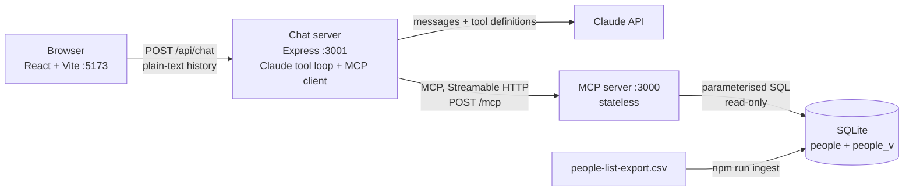

# People MCP Chat

An **MCP server** that ingests `people-list-export.csv` into **SQLite** and serves it over **Streamable HTTP on `/mcp`**, plus a **web chat** that answers natural-language questions ("How many people live in London?", "What is the average age of employees?") by letting Claude call that server's tools.

Design principles:
- **Correct by construction:** the server, not the model, owns the rules. Numbers come from parameterised SQL over an allowlist of fields, and salaries in different currencies can't be mixed.
- **Transparent:** every answer shows the tool calls behind it, with the generated SQL and the raw result.
- **Simple (KISS):** each layer is small enough to read in one sitting, and every dependency earns its place.

| Brief requirement | Where |
|---|---|
| Ingest the people file into a SQLite file | `npm run ingest` → `data/people.db` ([`src/ingest.ts`](src/ingest.ts)) |
| MCP server, Streamable HTTP on `/mcp` | [`src/mcp/server.ts`](src/mcp/server.ts), official MCP TypeScript SDK v2 |
| A clear, robust query API | Two tools: `describe_people_data` and `query_people` ([`src/mcp/tools.ts`](src/mcp/tools.ts), [`src/mcp/query.ts`](src/mcp/query.ts)) |
| Chat web app that talks to the MCP server | React UI ([`web/`](web/)) → chat backend, which is an MCP client ([`src/chat/`](src/chat/)) |
| Clearly display the response | Markdown answer, plus a collapsible **Tool calls** panel showing each call's input, the generated SQL and the raw result |

## Quick start

Requirements: **Node.js 24+** (it uses the built-in `node:sqlite` and runs TypeScript directly, with no build step) and an **Anthropic API key**.

```bash
git clone https://github.com/liortal2/people-mcp-chat.git
cd people-mcp-chat
npm install
cp .env.example .env        # then put your key in ANTHROPIC_API_KEY
npm run ingest              # CSV -> data/people.db
npm run dev                 # MCP :3000, chat API :3001, web :5173
```

Open **http://localhost:5173** and ask a question. Expand **Tool calls** under an answer to see what the model asked the server and what came back.

| Script | What it does |
|---|---|
| `npm run ingest` | Rebuilds `data/people.db` from the CSV (safe to re-run) |
| `npm run dev` | Starts all three processes: `mcp`, `chat`, `web` |
| `npm test` | Unit tests for ingest and the query compiler (20 tests, no API key needed) |
| `npm run typecheck` | `tsc` for the backend and the web app |
| `npm run eval` | End-to-end eval: 11 questions through the real model and MCP server (needs the MCP server running and a key) |

If port 3000 is already taken, move the MCP server: `MCP_PORT=3100 MCP_URL=http://localhost:3100/mcp npm run dev`. Vite picks the next free port by itself.

Settings (in `.env` or the environment): `CLAUDE_MODEL` (default `claude-haiku-5-5`; `claude-sonnet-5-5` for a stronger demo), `MCP_URL` (default `http://localhost:3000/mcp`), `MCP_PORT`, `CHAT_PORT`, `DB_PATH`.

**Trying the MCP server on its own:** run `npm run mcp`, then `npx @modelcontextprotocol/inspector` and connect over Streamable HTTP to `http://localhost:3000/mcp`.

## Architecture



## The MCP tools

**`describe_people_data`**: every queryable field with its type and meaning. For categorical fields it also gives the values with counts (for example `city: { London: 55, New York: 27, Tel Aviv: 24 }`), and for numbers and dates the min and max. It ends with short notes on the data's rules. The model calls it when it's unsure how a word maps to the data. "Place", for example, can mean city, country or office.

**`query_people`**: one structured, composable query, validated by zod and compiled to SQL.

| Part | Meaning |
|---|---|
| `filters[]` | `{ field, op: eq \| contains \| gt \| lt, value }`, all AND-ed. Text `eq` is case-insensitive. Dates go in as DD/MM/YYYY. |
| `aggregate` | `{ fn: count \| avg \| min \| max, field? }`: one computed value instead of rows |
| `group_by` | A categorical field: one value per group. Without `aggregate`, it counts per group. |
| `sort`, `limit` | Row mode: sorted, at most 50 rows (default 20). One extra row is fetched to set `truncated: true`. |

Every result includes the generated `sql` and `params`, so the answer can be checked in the UI. Bad input, such as an unknown field, `avg` of a text field, `gt` on text or a misplaced key, returns a clear error with `isError: true`. The model reads that error and corrects its call.

## Data quirks handled at ingest

107 rows of a fictional bakery, "Crumb & Culture", with offices in London (55), New York (27) and Tel Aviv (24).

- **DD/MM/YYYY dates** are parsed explicitly, and impossible dates (such as 31/02) are rejected: ingest rolls back and fails loudly.
- **Currency `"GBP £"`** is normalised to `GBP`. The salary period is normalised to `yearly` / `monthly` / `hourly`, or NULL.
- **Empty strings become NULL.** One `pending_arrival` record (hired, not started yet) has almost every field empty. Ingest warns about it, and the model says whether "employees" includes it.
- **Accents and quoted nicknames** (`Céline`, `Barnaby 'Bee' Quiller`) are handled by a real CSV parser (`csv-parse`).
- **Office, city and country are one-to-one**, so "Place" can match any of them.
- The CSV is committed to make the repo easy to run. It includes one `@shapes.co` test address.

## Tests and eval

- **`npm test`**: 20 unit tests, no API key needed. They cover the date and currency parsing, values always going in as placeholders (an injection string stays a harmless parameter and matches nothing), unknown fields and keys rejected, type checks on operators and aggregates, salary auto-splitting, the row cap and `truncated`, DD/MM/YYYY in and out, and chronological ordering of date groups.
- **`npm run eval`**: 11 questions through the real `runChat`, meaning the real model and the real MCP server. Expected answers are computed independently with plain SQL on the `people` table (and JS for ages), **not** through the query compiler or the view, so a bug there can't make a wrong answer look right. An answer passes when every expected number (with a tolerance for averages) and every expected name appears in it.

| Model | Result | Tokens (input + output) | Cost |
|---|---|---|---|
| `claude-haiku-5-5` | **11/11** | ~58k + 2.9k | ~$0.007 |
| `claude-sonnet-5-5` | **11/11** | ~55k + 2.3k | ~$0.13 |

Run on 2026-10-29. The questions: London count, Israel count, average age, Bread team size, the largest office, Orly Naveh's 7 reports, the longest-serving person, NYC average salary, people not started yet, people over 40, and the gender split in Tel Aviv.

Limits of the eval: a number counts if it appears anywhere in the answer, and each question runs once. It catches regressions; it isn't a statistical accuracy measure. Answers vary between runs (the same question took 1 tool call in one run and 3 in another).
